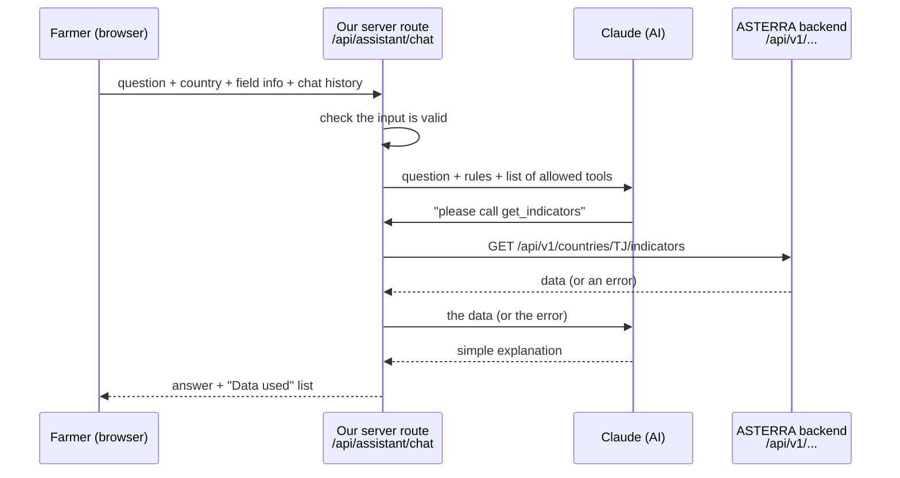

# ASTERRA AI Assistant

A chat box where a farmer asks questions like *"What can I plant next season?"* and gets a plain-language answer based on ASTERRA's real backend data.

> **Status (read this first)**
> - ✅ Code written, 12 unit tests pass, TypeScript compiles.
> - ⚠️ Tests use a **fake** backend and a **fake** AI. It has **not** been run against our real backend yet.
> - ⚠️ It is **not plugged into the ASTERRA website yet** (needs ~10 minutes, see "Add it to the website").

---

## 1. The idea in 30 seconds

The AI **does not know any farming data by itself and does not decide which crop is best.**
Our backend does the data and the ranking. The AI only:
1. asks the backend for data (through a short list of allowed "tools"),
2. explains the result in simple words,
3. says clearly when data is missing.

This follows our *Global Crop Rotation Workflow*: *"Rules and verified data determine rankings; an optional LLM only explains the results."*

## 2. How a question travels



Why it goes through our server: **API keys must never be in the browser.**

## 3. What's in the folder

| File | What it does (one line) |
|---|---|
| `src/components/assistant/AssistantPanel.tsx` | The chat UI: messages, input, Send button, loading, errors, suggested questions |
| `src/components/assistant/assistant.css` | Styles (colors can be changed with CSS variables) |
| `src/components/assistant/renderMarkdown.tsx` | Shows lists, bold text and tables in answers |
| `src/app/api/assistant/chat/route.ts` | The server endpoint the chat calls. Validates, rate-limits, returns errors nicely |
| `src/lib/assistant/chat.ts` | The loop: ask AI → AI wants data → fetch it → give it back → final answer |
| `src/lib/assistant/tools.ts` | **The only things the AI is allowed to do** (each = one documented backend endpoint) |
| `src/lib/assistant/backendClient.ts` | Talks to our backend; handles timeouts and error responses |
| `src/lib/assistant/systemPrompt.ts` | The AI's rulebook (never invent numbers, say when data is missing, etc.) |
| `src/lib/assistant/anthropic.ts` | Calls the Claude API |
| `src/lib/assistant/validate.ts` | Checks user input (length, allowed values) |
| `src/lib/assistant/config.ts` | Reads environment variables |
| `src/lib/assistant/types.ts` | Shared TypeScript types (including the `FieldContext` shape) |
| `tests/assistant.test.ts` | 12 automated tests |
| `.env.example` | The settings you need to fill in |

## 4. Safety rules built in

- 🔑 API keys stay on the server only.
- 🔒 The AI can only call the tools in `tools.ts`. The **country is set by the server**, the AI cannot pick another one.
- ✅ Every tool input is checked before it reaches the backend.
- 🚫 The AI is told never to invent measurements, never to claim "NASA data says…" unless a tool result shows it, and never to give profit numbers without local prices.
- 🧾 Every answer shows a **"Data used"** list (source, date, status, or the error).
- ⏱️ Timeouts: backend 8 s, AI 45 s. Rate limit: 12 questions/minute per IP (basic, see limits below).

## 5. Quick start (run the tests)

```bash
npm install
npm test            # 12 tests should pass
npm run typecheck   # should print nothing
```

## 6. Add it to the website

Our site looks like a **Next.js** app. We could not see its code, so adjust paths if yours differ.

1. Copy `src/lib/assistant/`, `src/components/assistant/` and `src/app/api/assistant/chat/route.ts` into the website project. If your folder layout is different, fix the `import` paths at the top of `route.ts`.
2. Copy `.env.example` values into `.env.local` (and into Vercel → Settings → Environment Variables):

   | Variable | Required | Meaning |
   |---|---|---|
   | `ASTERRA_API_BASE_URL` | yes | Backend address, e.g. `https://our-backend.example.com` (no `/api/v1` at the end) |
   | `ANTHROPIC_API_KEY` | yes | Claude API key |
   | `ASTERRA_API_KEY` | only if backend needs login | Sent as `Authorization: Bearer …` |
   | `ASSISTANT_MODEL` | no | Defaults to `claude-sonnet-5-5` |

3. Put the chat on the page where the country is known:

   ```tsx
   import AssistantPanel from '@/components/assistant/AssistantPanel';

   <AssistantPanel
     countryCode={selectedCountry.code}   // see "Known problems" #3
     countryName={selectedCountry.name}
     field={fieldContext}                 // optional, see below
   />
   ```

4. `fieldContext` is what the farmer told us (all optional, `"unknown"` is fine):

   ```ts
   {
     regionId: 'region-001',
     centroid: { latitude: 38.5, longitude: 68.7 },
     areaHectares: 3.2,
     previousCrops: ['corn', 'corn'],     // latest first, max 2
     irrigation: 'rainfed',               // rainfed | irrigated | both | unknown
     plannedPlanting: 'spring',
     priority: 'soil',                    // profit | yield | water | soil | risk | unknown
     issues: 'some pests last year',
     soilType: 'clay'
   }
   ```

## 7. Backend endpoints the AI can use

All come from *ASTERRA_Backend_API_Requirements*. Nothing is invented.

| Tool name | Backend call |
|---|---|
| `get_country_dashboard` | `GET /countries/{code}/dashboard` |
| `get_indicators` | `GET /countries/{code}/indicators` (or `/indicators/{name}`) |
| `get_climate_series` | `GET /countries/{code}/climate/{temperature\|precipitation\|soil-moisture\|vegetation\|summary}` |
| `get_insights` | `GET /countries/{code}/insights` |
| `get_risk_assessment` | `GET /countries/{code}/risk-assessment` |
| `list_crops` / `get_crop` | `GET /countries/{code}/crops` / `/crops/{id}` |
| `get_existing_crop_recommendations` | `GET /countries/{code}/crop-recommendations` |
| `analyze_crop_rotation` | `POST /countries/{code}/crop-recommendations/analyze` |
| `get_data_source_status` | `GET /data-sources/status` |

## 8. Known problems (team decisions needed)

1. **Backend is country/region level, not field level.** The workflow describes a drawn field; the API spec has no field endpoint. The AI tells the farmer when it is using regional data. *Possible fix:* backend adds a way to turn a field point into a `regionId`.
2. **The analyze endpoint accepts less than our questionnaire asks.** It only takes `regionId, currentCrop, soilType, season, priorities`. Irrigation, pests, budget, 2nd previous crop and profit/yield/risk goals are discussed by the AI but **do not change the backend ranking**. Only `water-efficiency` and `soil-health` priorities are documented, so only those are sent.
3. **Country codes differ.** The API spec says 2 letters (`TJ`); the website's flag files use 3 letters (`TJK`). Fix in `normalizeCountryCode()` in `validate.ts` once we know what the backend accepts.
4. **Crop recommendations are "Priority 3" in the API spec.** If the backend doesn't implement them yet, the AI will say so and give only general advice (clearly marked as general).
5. **No price/cost data**, so the AI refuses to give profit numbers (as the workflow requires).
6. **Login / rate limits / pagination** are not defined in the spec. We send a Bearer token only if `ASTERRA_API_KEY` is set.

## 9. What is and isn't tested

| | |
|---|---|
| ✅ Tested (with fakes) | input validation, backend errors/timeouts, tool whitelist, country locking, follow-up questions keep context, backend failure is reported honestly, runaway-loop stop, route error codes |
| ❌ Not tested | real backend, real Claude answers, inside the real website, browser/mobile layout, console errors |
| ⚠️ Limits | rate limiter is per server instance only (use Redis/Upstash for real protection); chat history lives in the browser tab (`sessionStorage`) and is lost when the tab closes |

## 10. Checklist

- [x] Assistant server code
- [x] Chat UI component
- [x] Uses only documented backend endpoints
- [x] Conversation context (follow-up questions)
- [x] Loading, error and empty states (written)
- [x] Unit tests + type-check
- [ ] Added to the ASTERRA website
- [ ] Tested against the real backend
- [ ] Tested on mobile in a browser
- [ ] Field-level data (needs backend work)
- [ ] Real-field demo for the competition
